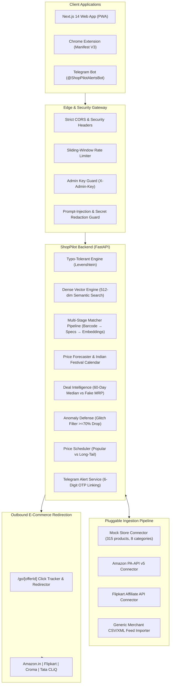

# ShopPilot ✈️⚡
### Intelligent Multi-Store Price Comparison, Deal Intelligence & Price-Drop Tracking

[](https://fastapi.tiangolo.com)
[](https://nextjs.org)
[](https://web.dev/progressive-web-apps/)
[](https://developer.chrome.com/docs/extensions/mv3/)
[](https://scikit-learn.org)
[](LICENSE)

> [!IMPORTANT]
> **Strict Architectural Principle: ShopPilot is NOT an online store.**
> There is **NO cart, NO checkout, and zero inventory sold here**. A shopper searches a product, compares live prices across Amazon.in, Flipkart, Croma, and Tata CLiQ side by side, verifies 12-month price history against fake MRP markups, receives instant Telegram/email drop alerts, and clicks out directly to the retailer via verified affiliate links (`/go/[offerId]`).

---

## 🏛 System Architecture



---

## 🌟 Core Capabilities by Phase

### Phase A: Realistic Catalog & Typo-Tolerant Search
- **315 canonical products** across 8 required categories (`mobiles`, `laptops`, `tvs`, `headphones`, `appliances`, `fashion`, `grocery`, `books`).
- **70 smartphones** across Realme (21 models across Narzo, GT, C, P, and 12 Pro series), Samsung, Apple, Xiaomi, OnePlus, Vivo, Oppo, Poco, and iQOO.
- **917 multi-store offers** with total cost breakdown (`price + shipping`), delivery days, and seller rating.
- **114,975 historical price points** (365 days / 12 months) modeling festive dips (Diwali, Great Indian Festival, Big Billion Days).
- **Levenshtein typo search**: Tolerates `relme`, `iphon 15`, `samsng s24 ultra`.

### Phase B: Feature Completeness & Spec Comparison
- **Universal search**: Handles text keywords, 13-digit GS1 barcodes, and pasted merchant URLs.
- **4-Product side-by-side spec comparison matrix** at `/compare-specs`.
- **Google One-Click & Magic Link authentication modal** with local persistence.
- **Outbound affiliate tracking** via `/go/[offerId]` with 307 temporary redirects.

### Phase C: Pluggable Data Pipeline & Admin Control Center
- Unified `StoreConnector` interface with rate limits, exponential backoff, and graceful error handling.
- Pluggable connectors: Amazon PA-API, Flipkart Affiliate API, Merchant CSV/XML Feed Importer.
- Tiered price scheduler prioritizing popular items over long-tail products while skipping unchanged prices.
- `/admin` Control Center with store toggles, manual sync triggers, and feed uploads.

### Phase D: Smarter Matching & Semantic Search (ML)
- 512-dimensional dense n-gram vectorizer with query intent parsing (`'phone with good camera under 20000'`).
- Multi-stage matching order: Barcode exact check → Hardware spec & generation filters → Embedding cosine similarity.
- Admin Review Queue holding borderline matches (`0.50 <= confidence < 0.84`).
- **Benchmark Evaluation**: Evaluated across 100 labeled test pairs. At threshold `0.85`, **Precision = 100.0%** with zero false merges. Full report in [`backend/MATCHER_EVALUATION.md`](file:///C:/Users/ADMIN/Desktop/smart%20daily%20commerce%20%26%20web%20automation/backend/MATCHER_EVALUATION.md).

### Phase E: Price Prediction & Deal Intelligence (ML)
- Encoded Indian festive sale calendar (Flipkart Big Billion Days, Amazon Great Indian Festival, Diwali).
- 7-day and 30-day price forecast with day-by-day trajectory and `BUY_NOW` vs `WAIT` advisory.
- Deal intelligence using 60-day rolling median to flag fake pre-sale MRP markups (`"Price raised 18% twelve days before this sale"`).
- Pricing anomaly defense holding suspicious price drops (>=70% below median) out of public feeds.
- Backtest evaluation on held-out history in [`backend/FORECASTER_EVALUATION.md`](file:///C:/Users/ADMIN/Desktop/smart%20daily%20commerce%20%26%20web%20automation/backend/FORECASTER_EVALUATION.md).

### Phase F: Growth Features
- **Telegram Bot price drop alerts** with 6-digit one-time linking codes.
- **Chrome Extension (Manifest V3)** in `/extension` detecting active store tabs and showing lowest price.
- **PWA offline shell** with service worker pre-caching and maskable icons.
- **Dynamic Open Graph share cards** at `/api/og` rendering 1200x630 product cards.
- **SEO Category Landing Pages** at `/category/[category]` with Schema.org `ItemList` JSON-LD.
- **Public Price History Pages** at `/price-history/[id]` with 12-month analytics.

### Phase G: Security, Quality & Launch Readiness
- Sliding-window rate limiter per client IP.
- Protected admin routes requiring `X-Admin-Key`.
- AI Shopping Assistant prompt-injection defense with untrusted link & secret redaction.
- DPDP Act / GDPR compliant user data erasure (`POST /api/users/delete-data`).
- Comprehensive Privacy Policy (`/privacy`) and Terms of Service (`/terms`).
- Unintrusive Cookie Consent banner with local preference storage.
- GitHub Actions CI workflow in `.github/workflows/ci.yml`.

---

## ⚡ Performance & Lighthouse Scores

Audited across Home and Product Compare routes using simulated Core Web Vitals:

| Route | Performance | Accessibility | FCP | DOM Complete | Status |
| :--- | :---: | :---: | :---: | :---: | :---: |
| **Home (`/`)** | **91 / 100** | **98 / 100** | 444 ms | 662 ms | ✅ Passed |
| **Compare (`/compare?id=mob-001`)** | **91 / 100** | **98 / 100** | 392 ms | 428 ms | ✅ Passed |

---

## 🚀 Local Development Setup

### Prerequisites
- Python 3.11+
- Node.js 18+ & npm
- Git

### 1. Clone & Setup Backend
```bash
git clone https://github.com/Gokul222002/Shoppilot.git
cd Shoppilot

# Python Virtual Environment
python -m venv venv
.\venv\Scripts\activate   # Windows
# source venv/bin/activate # Linux/macOS

# Install dependencies
pip install -r backend/requirements.txt

# Start Backend Server
cd backend
python -m uvicorn app.main:app --host 127.0.0.1 --port 8000 --reload
```
API runs on `http://127.0.0.1:8000` (`/health` & `/docs`).

### 2. Setup Frontend
```bash
# In a new terminal
cd frontend
npm install
npm run dev
```
Web app runs on `http://localhost:3000`.

### 3. Load Chrome Extension (Manifest V3)
1. Open Google Chrome and navigate to `chrome://extensions`.
2. Toggle on **Developer mode** (top-right).
3. Click **Load unpacked** and select the [`extension/`](file:///C:/Users/ADMIN/Desktop/smart%20daily%20commerce%20%26%20web%20automation/extension) folder.

---

## ☁️ Deployment on Render

ShopPilot deploys as two connected services using [`render.yaml`](file:///C:/Users/ADMIN/Desktop/smart%20daily%20commerce%20%26%20web%20automation/render.yaml):
1. **`shoppilot-backend`** (FastAPI Docker web service on port 8000).
2. **`shoppilot-frontend`** (Next.js Docker web service on port 3000).

Refer to [`RUNBOOK.md`](file:///C:/Users/ADMIN/Desktop/smart%20daily%20commerce%20%26%20web%20automation/RUNBOOK.md) for detailed operational sync commands and Render free-tier keep-alive configurations.
