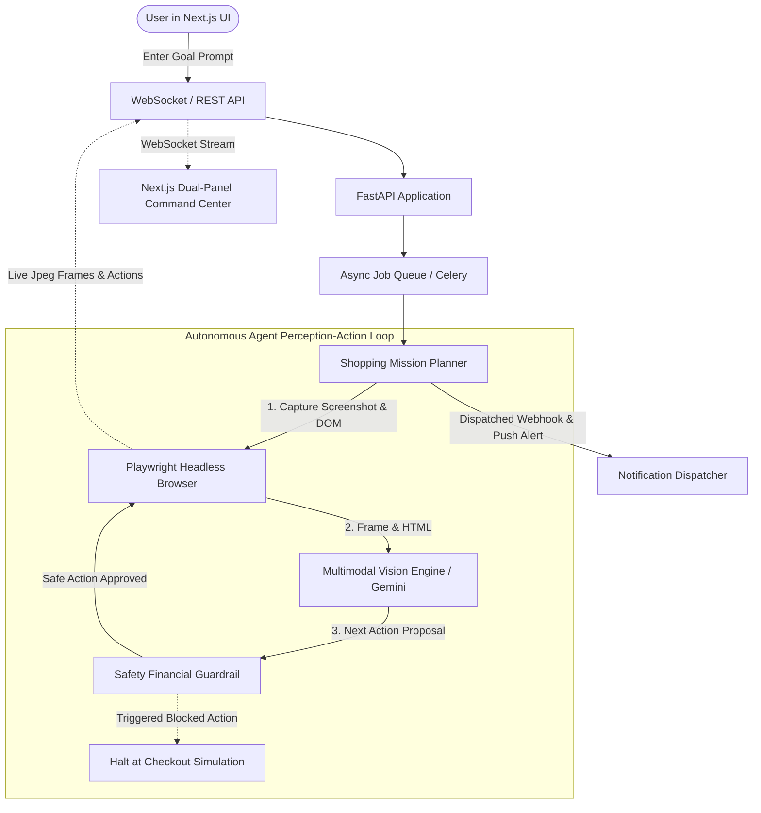

# ShopPilot 🛒⚡
### Autonomous Multimodal Browser Agent for Automated Deal Hunting & Checkout Simulations

[](https://fastapi.tiangolo.com)
[](https://nextjs.org)
[](https://playwright.dev)
[](https://ai.google.dev)
[](https://python.org)
[](https://typescriptlang.org)

**ShopPilot** is an autonomous full-stack AI agent capable of navigating complex e-commerce interfaces, bypassing promotional popups, analyzing product specifications and budgets using multimodal vision, adding matched items to cart, and safely simulating the checkout flow—all while streaming live browser screenshots and execution logs over WebSockets to an interactive command center dashboard.

---

## 🌟 Key Features

1. **Natural Language Shopping Objectives**:
   - Accepts open-ended user requests (e.g., *"Find a 4K 27-inch monitor under $300 and add it to cart"*, *"Find running shoes under $80 on sale"*).
2. **Autonomous Headless Browser Navigation**:
   - Powered by Playwright Chromium with dynamic DOM tree simplification, real-time action bounding box visualizers, and screenshot capture hooks.
3. **Dual Multimodal Vision Engine**:
   - **Google Gemini 1.5 / 2.0 Vision API**: Analyzes screenshots and simplified interactive DOM elements to reason about dynamic popups, deal badges, and button states.
   - **Intelligent Deterministic Heuristics**: Zero-configuration fallback engine guaranteeing 100% offline and demo reliability with zero API downtime or rate-limit blocks.
4. **Real-time Live WebSocket Stream**:
   - Streams base64 browser frames, agent internal thoughts, active CSS selectors, confidence scores, and action progress straight to the Next.js UI canvas.
5. **Zero-Charge Financial Safety Guardrail**:
   - Strict autonomous boundary intercepts any attempt to type credit card numbers, CVVs, or click final `Place Your Order` payment triggers. The agent simulates cart and checkout confirmation without financial risk.
6. **Simulated Push Notifications & Webhook Dispatcher**:
   - Dispatches webhook alerts (`DEAL_FOUND`, `ADDED_TO_CART`, `SAFETY_HALT`) to connected WebSockets and external endpoints (Slack, Discord, Zapier).
7. **Integrated Mock Store Sandbox**:
   - Built-in realistic e-commerce store (`/mock-store`) featuring dynamic flash deal promotional modals, client-side catalog search, inventory specs, and interactive cart drawers.

---

## 🏛 Architecture & Execution Flow



---

## 📂 Repository Structure

```
smart daily commerce & web automation/
├── backend/
│   ├── app/
│   │   ├── config.py             # Settings, Gemini API key, browser settings, safety flags
│   │   ├── main.py               # FastAPI server, REST & WebSocket routes
│   │   ├── agent/
│   │   │   ├── browser.py        # Playwright controller: streaming screenshots & DOM extractor
│   │   │   ├── vision_llm.py     # Gemini Vision multimodal parser & smart heuristic agent
│   │   │   ├── planner.py        # Mission state machine: perceive -> plan -> act -> observe
│   │   │   └── safety.py         # Autonomous payment blocker & checkout simulation guardrail
│   │   ├── mock_store/
│   │   │   ├── products.py       # Catalog data (monitors, audio, laptops, shoes)
│   │   │   └── router.py         # Realistic demo store with search, cart, and popups
│   │   ├── notifications/
│   │   │   └── dispatcher.py     # Webhook dispatcher & in-app alert emitter
│   │   └── worker/
│   │       ├── queue.py          # Asynchronous job queue manager
│   │       └── celery_worker.py  # Celery worker configuration for distributed clusters
│   ├── requirements.txt
│   ├── Dockerfile
│   └── tests/
│       ├── test_api.py           # FastAPI endpoints & mock store tests
│       ├── test_safety.py        # Safety guardrail verification tests
│       └── test_agent.py         # Multimodal reasoning tests
├── frontend/
│   ├── package.json
│   ├── tsconfig.json
│   ├── tailwind.config.js
│   ├── next.config.mjs
│   └── src/
│       ├── app/
│       │   ├── layout.tsx
│       │   ├── page.tsx          # Dual-panel command center dashboard
│       │   └── globals.css
│       └── components/
│           ├── LiveBrowserFeed.tsx    # Live screenshot stream canvas with interactive overlays
│           ├── ActionLogTimeline.tsx  # Chronological step execution logs & thoughts
│           ├── DealCard.tsx           # Extracted deal display with specs & discount badges
│           ├── GoalInputBar.tsx       # Natural language objective input with sample presets
│           ├── SafetyIndicator.tsx    # Visual safety check and payment prevention status
│           └── NotificationToast.tsx  # Simulated push notifications & webhook alerts
├── scripts/
│   ├── start_backend.bat         # 1-click Windows backend launcher
│   ├── start_frontend.bat        # 1-click Windows frontend launcher
│   ├── start_all.bat             # 1-click full-stack launcher
│   └── run_e2e_test.py           # Automated WebSocket E2E integration verification
├── docker-compose.yml
├── .env.example
└── README.md
```

---

## 🚀 Quickstart Guide

### Option 1: One-Click Launch (Windows)

Simply double-click:
```cmd
scripts\start_all.bat
```
This automatically starts:
- **Backend API & WebSocket Server**: [http://localhost:8000](http://localhost:8000)
- **Next.js Dashboard**: [http://localhost:3000](http://localhost:3000)
- **Interactive Sandbox Store**: [http://localhost:8000/mock-store](http://localhost:8000/mock-store)

---

### Option 2: Manual Terminal Setup

#### 1. Backend Setup (FastAPI & Playwright)
```bash
# Navigate to project root
cd "c:\Users\ADMIN\Desktop\smart daily commerce & web automation"

# Activate Python virtual environment
.\venv\Scripts\Activate.ps1   # or .\venv\Scripts\activate.bat

# Install Python dependencies (already installed in venv)
pip install -r backend/requirements.txt

# Install Playwright browser binaries
python -m playwright install chromium

# Launch FastAPI Backend
cd backend
python -m uvicorn app.main:app --host 127.0.0.1 --port 8000 --reload
```

#### 2. Frontend Setup (Next.js 14)
```bash
# In a second terminal:
cd "c:\Users\ADMIN\Desktop\smart daily commerce & web automation\frontend"

# Install dependencies (already completed)
npm install

# Start Next.js Development Server
node ./node_modules/next/dist/bin/next dev -p 3000
```
Open **[http://localhost:3000](http://localhost:3000)** in your browser.

---

### Option 3: Docker Compose

```bash
# Run with distributed Redis & Celery
docker-compose up --build
```

---

## ⚙️ Configuration (`.env`)

| Variable | Default | Description |
|---|---|---|
| `PORT` | `8000` | FastAPI server listening port |
| `GEMINI_API_KEY` | *(Optional)* | Google Gemini API Key for Vision LLM reasoning. If omitted, operates in Smart Heuristic Mode. |
| `VISION_MODEL_NAME` | `gemini-1.5-flash` | Gemini model to use (`gemini-1.5-flash`, `gemini-2.0-flash`) |
| `HEADLESS` | `true` | Runs Playwright in headless background mode |
| `MAX_STEPS` | `15` | Maximum steps per autonomous shopping mission |
| `ENABLE_PURCHASE_PREVENTION` | `true` | Safety flag halting execution at payment/checkout boundary |
| `WEBHOOK_URL` | `http://localhost:8000/api/webhook/mock` | Target URL for external alert notifications |
| `REDIS_URL` | `redis://localhost:6379/0` | Redis broker URL for Celery task queuing |

---

## 🧪 Testing & Verification

The repository includes a comprehensive automated test suite covering unit tests, safety guardrails, and real-time end-to-end WebSocket missions.

### 1. Run Unit & Safety Guardrail Tests
```bash
cd backend
..\venv\Scripts\python.exe -m pytest -v
```
**Results**:
- `test_heuristic_dismisses_popup`: PASSED
- `test_heuristic_identifies_search`: PASSED
- `test_heuristic_finds_deal_under_budget`: PASSED
- `test_health_check_endpoint`: PASSED
- `test_mock_store_html_render`: PASSED
- `test_mock_store_search_filter`: PASSED
- `test_create_and_list_job`: PASSED
- `test_mock_webhook_endpoint`: PASSED
- `test_safety_guardrail_blocks_payment_submission`: PASSED
- `test_safety_guardrail_blocks_credit_card_input`: PASSED
- `test_safety_guardrail_permits_safe_search_and_cart`: PASSED
- `test_safety_guardrail_flags_checkout_warning`: PASSED

### 2. Run End-to-End Autonomous Agent Verification
```bash
python scripts\run_e2e_test.py
```
This launches a live Playwright session, dispatches the prompt *"Find a 4K 27-inch monitor under $300 and add it to cart"*, connects to WebSockets, verifies popup dismissal, product search, deal identification, cart addition, and push notifications with zero manual intervention.

---

## 🔒 Safety & Ethical Automation Notice
ShopPilot is designed strictly for price monitoring, deal research, and checkout flow simulation in controlled testing environments. The built-in **Financial Safety Guardrail** explicitly intercepts sensitive inputs (credit card numbers, CVVs, passwords) and aborts execution before financial transactions occur.
